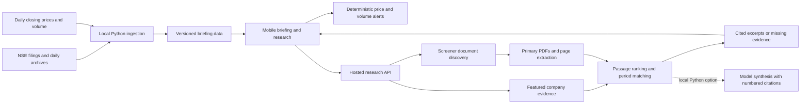

# FINN

FINN combines an Indian-equity portfolio briefing with research from primary company documents. The historical demo opens on 10–22 April 2025. Choose Last 24h or Last 7 days to see disclosures in a rolling window.

## Run locally

Use Python 3.10 or newer. From this directory run:

```sh
python -m pip install -r requirements.txt
python backend.py --port 8000
```

Open http://127.0.0.1:8000. The Python service serves both the mobile interface and the research API. The hosted version uses a JavaScript Worker for the same research interaction. Build it with `node build-worker.mjs` after installing the locked dependencies. Run `python warm_research.py` to regenerate the four featured companies’ page-cited evidence before building.

## Try it

1. Open the Infosys result and expand its quarterly figures. Inspect the two linked financial statements.
2. Open Research company and inspect the two FY25 comparisons. The revenue comparison flags the change in acquisition scope.
3. Open PERSISTENT and ask “What was revenue growth?” to retrieve cited passages from outside the demo set. Test “What is the FY29 dividend payout target?” to see how FINN handles missing evidence.
4. Change the price or volume threshold under Portfolio. The briefing applies those settings to stored daily observations. Portfolio preferences persist in this browser.

## Data and operations

Run `python refresh.py` to update prices and recent filings. Supply symbols such as `python refresh.py INFY` to refresh a subset. Each source can fail independently. Failed downloads retain the previous records. Run one refresh at a time.

`python market_snapshot.py` rebuilds the historical daily price dataset from NSE bhavcopy CSVs. Reapply refresh.py after a historical rebuild. Price changes use the prior close. Volume multiples use the preceding twenty sessions. Historical company results and guidance in dist/events.json and dist/results.json were reviewed against the linked issuer documents.

Research discovers annual reports and transcripts by ticker, extracts PDF text with page numbers, and ranks passages by query-term overlap. The SQLite cache stores fetched documents and market responses locally. Set FINN_CACHE to change its directory. Text extraction skips pages with insufficient text. Coverage depends on document availability.

Evidence search runs without a model key. For model-written synthesis, configure FINN_MODEL_URL (a chat completions endpoint), FINN_MODEL_NAME, and FINN_MODEL_KEY in the server environment. The service supplies only retrieved passages, checks returned citation indices, and falls back to excerpts when synthesis is unavailable. Citation indices alone do not establish that a claim follows from the cited text.

## Prototype limits

The eight manually reviewed guidance comparisons demonstrate the intended analysis. Fully automated guidance extraction, OCR, scheduled refresh, and push delivery outside the app are future work. Unreviewed synced filings show exchange metadata. The historical snapshot includes six reviewed disclosures and sixteen companies with market observations.

## Architecture



The hosted path returns extractive evidence. Financial comparisons and percentage changes use code. Showcase guidance comparisons are reviewed against the issuer disclosures. The local Python service can optionally synthesise retrieved passages with a configured model.


## Expanded coverage · 15 November 2026
Explore contains NVIDIA, Tesla, Apple, Microsoft and Jio Platforms profiles with dated primary sources. These five add to the 16-company Indian portfolio. Nine companies have pre-indexed research evidence. New entries are explicitly marked reviewed source summaries, not verbatim extracts; their currencies and reporting periods are preserved. These are selected disclosures, not a live price feed.

The IPO tab records 12 candidates from the 13 November 2026 SEBI processing report. Processing is not regulatory approval or a confirmed issue date. Jio’s closed October offer is excluded from upcoming candidates. A separate chat automation monitors official announcements on Monday, Wednesday and Friday mornings; it does not write to the website.

Validate expanded coverage with `node check-coverage.mjs` after `node build-worker.mjs`.
