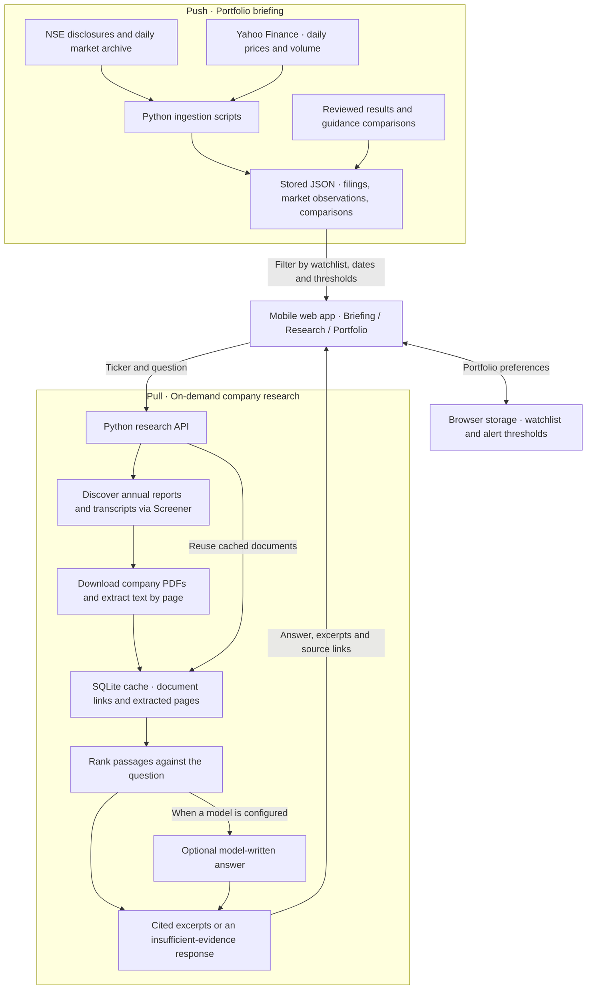

# FINN build history

Selected user and assistant messages exported from the project chat. Tool calls, local paths and account-specific links are omitted. Long messages may be truncated by the export tool.

## User

Hi, there I have added two documents in the folder make me understand the task

## Assistant

You’re being asked to build **FINN: a mobile-first AI assistant that helps an investor spot important developments and research Indian listed companies.**

The main idea is: **save the investor time by filtering information and explaining what matters.** A focused, working product matters more than having lots of features.

The challenge is described in (challenge PDF). The finance terminology and announcement categories are explained in (challenge PDF); that second document is a reference guide, not an additional assignment.

**What the app should do**

There are two modes:

| Mode | In plain English | Example |
|---|---|---|
| **Push** | The app proactively surfaces important changes. | “A company in your portfolio reported results. Profit fell despite higher sales.” |
| **Pull** | The investor asks the app to investigate a company. | “Has this company delivered what management promised?” |

For the demo, choose **15–20 NSE/BSE-listed companies** as a mock portfolio, preferably across different sectors and sizes. Also select **3–5 companies** to demonstrate on-demand research. The research engine must work for other NSE tickers where data is available; it cannot be hardcoded to your examples.

**The data you need**

The brief asks you to connect three types of data:

- **Daily price and trading volume:** how the share price moved and how many shares traded. Yahoo Finance or an equivalent source is acceptable.
- **Exchange announcements:** company disclosures from NSE/BSE, such as results, acquisitions, management changes, or dividends.
- **Company documents:** annual reports and earnings-call transcripts, available through Screener links or company investor-relations websites.

For **Pull research**, use the company’s primary documents. Do not base the analysis on news, broker reports, or the model’s remembered knowledge.

**What Push could look like**

An investor opens the app and sees a prioritised digest for the last 24 hours, with an option to change the period.

Important developments appear first; routine paperwork is collapsed. The investor can configure alerts for things such as a large daily price move or trading volume exceeding twice its recent average.

The useful part is the explanation. For example:

- A results announcement could show revenue and profits compared with the previous quarter and the same quarter last year.
- A management appointment could include a short background on the incoming person.
- An acquisition could explain what was bought and why it deserves attention.

These are suggested workflows, not a requirement to implement every example. Also, the specified price data is **end-of-day**, so you do not need to build live intraday market tracking.

**What Pull could look like**

The investor searches for a company and asks a question. The app reads the relevant documents and provides a concise, grounded answer.

The brief offers eight possible research areas: business overview, financial overview, multi-year trends, debt and balance sheet, cash generation, management claims versus actual performance, guidance, and bull/bear arguments. **You do not have to implement all eight.**

One example they particularly value is:

> Compare what management promised over the last four quarters with what the company actually delivered.

That demonstrates analysis rather than simply summarising documents.

**How I would scope this**

My recommendation is to build two strong workflows:

1. **Portfolio briefing:** a mobile feed of prioritised announcements, concise explanations, source links, and configurable price/volume alerts.
2. **Company research:** a search and question interface that answers from annual reports and transcripts, with source references and one deeper analysis such as “promised versus delivered.”

A responsive website is explicitly acceptable. You do not need a native Android or iOS app.

They are evaluating your **product judgment, creativity, architecture, reliability, and use of AI**. Efficient extraction, caching, and sensible model choices earn bonus points. Their message is explicit: **thin but working beats broad but broken.**

**What you must submit**

- A working mobile-friendly prototype that they can easily try.
- The GitHub repository.
- Your AI build history: coding-agent and LLM conversations, exports, or share links. **Preserve these from the beginning.**
- A short covering email explaining what you built, key decisions and trade-offs, what you left out, and next steps.

Send it to **assessment@enam.com**, with the subject:

**IIT Delhi – AI Engineer - 2027**

The stated deadline is **15 November 2026—today in your timezone**. The document does not specify a cutoff time.

## User

# Response annotations:
Each item contains text selected from an earlier Codex response and may include a user comment. Treat items as Annotation 1, Annotation 2, and so on in array order. Use every selection as context and address every comment. For every annotation you address, include `:codex-annotation{index="N" id="ID"}`, where N is its one-based array position and ID is its exact id (omit the id attribute if absent). Do not use unstructured annotation labels.
[earlier recommendation selected]

## My request:
alright we will go with this, but before that tell me all the details

## Assistant

:codex-annotation{index="1" id="10fc601e-1916-4d30-bf23-d42e25b6440c"}

We’ll build **FINN around two connected workflows: a portfolio briefing that tells the investor what deserves attention, and company research that helps them investigate further.** Below is the proposed product, how it works, and what we should build first. These are implementation recommendations; the challenge leaves these choices to us.

**1. The product experience**

FINN should answer three questions quickly:

- What changed in the companies I follow?
- Why does it matter?
- What evidence should I examine next?

The main screen will be a mobile-friendly briefing. Tapping an item opens its details and original source. From there, the investor can ask a follow-up question or open the company’s research view.

We should use three primary navigation items: **Briefing, Research, and Portfolio**. Alert settings can sit inside Portfolio.

**2. Portfolio briefing: the Push workflow**

We start with a preset mock portfolio of 15–20 companies across sectors and company sizes. The user can see the selected companies and add or remove them.

The briefing includes:

| Feature | Proposed behaviour |
|---|---|
| Time window | Last 24 hours by default, with other periods and a custom range |
| Important developments | Material announcements displayed first |
| Routine disclosures | Collapsed into a quieter section |
| Market signals | Daily price and volume changes that cross configured thresholds |
| Source access | Every announcement links to its original filing |
| Freshness | Show when data was last fetched and which period it covers |

Each important announcement card should contain:

- Company name and announcement category.
- Filing timestamp.
- A factual headline.
- A short explanation of what changed.
- A clearly separated explanation of why it may matter.
- A source link and an action to investigate further.

For example, an acquisition card could show the target business, disclosed transaction value, and the strategic rationale stated by management. If the filing does not disclose a detail, FINN should say so.

The interface should avoid filling every card with generic commentary. Some announcements only need a short factual summary.

**3. How announcements get prioritised**

We should combine rules with AI rather than asking a model to invent an importance score from scratch.

The process:

1. Fetch the announcement and its attachment.
2. Identify the company, date, category, and document type.
3. Detect duplicate or related disclosures.
4. Extract the relevant facts.
5. Assign a priority using category, disclosed facts, and user preferences.
6. Generate the concise card.

Initial categories can follow the reference guide: results, acquisitions, fundraising, management changes, litigation, credit ratings, dividends, capex, and routine disclosures.

Priority should consider context. A large regulatory penalty can deserve more attention than a routine board-meeting notice. Multiple filings about the same results should form one event where practical.

We should display a brief reason for prioritisation, such as “Credit rating downgraded,” rather than an unexplained “AI score: 92.”

**4. Price and volume alerts**

These use end-of-day data. The prototype will evaluate signals after the latest daily data becomes available.

Proposed settings:

- Daily price change threshold, initially ±5%.
- Volume threshold, initially 2× the average of the previous 20 trading sessions.
- Announcement categories the user wants highlighted.

The calculations should be deterministic:

- **Price change:** latest close compared with the previous trading close.
- **Volume multiple:** latest volume divided by average volume over the preceding 20 sessions, excluding the current session.

These defaults are our choices, not requirements from the brief.

The app must distinguish a detected signal from an explanation. It can say that price moved and an announcement occurred on the same day; it should not claim the announcement caused the move without supporting evidence.

For the initial prototype, alerts can appear inside the app. Browser push notifications are a later enhancement.

**5. Results announcements**

Results deserve a structured view because raw filings are difficult to scan.

Where the filing supports it, we will show:

| Metric | Current quarter | Previous quarter | Same quarter last year | QoQ | YoY |
|---|---|---|---|---|---|
| Revenue | Extracted value | Extracted value | Extracted value | Calculated | Calculated |
| EBITDA | When available | When available | When available | Calculated | Calculated |
| PBT | Extracted value | Extracted value | Extracted value | Calculated | Calculated |
| PAT | Extracted value | Extracted value | Extracted value | Calculated | Calculated |

There are several details to handle carefully:

- Keep standalone and consolidated accounts separate.
- Preserve units, such as ₹ crore or ₹ lakh.
- Distinguish quarterly figures from cumulative year-to-date figures.
- Do not invent EBITDA when it is not disclosed or safely derivable.
- Flag comparisons affected by losses, zero denominators, or reporting changes.

The model extracts the figures; code performs arithmetic and checks consistency.

**6. Company research: the Pull workflow**

The investor searches for an NSE company, opens its research view, and asks a question.

The view should show:

- A concise business overview.
- Available annual reports and earnings-call transcripts.
- The dates covered by those sources.
- A question box with useful suggested questions.
- A dedicated “Promises vs performance” analysis.

Example questions:

- “What are this company’s main businesses?”
- “What risks does management identify?”
- “What is management saying about margins?”
- “What changed in its expansion plans?”
- “Has management delivered its growth guidance?”

Answers should be concise first, with supporting evidence available underneath. Each substantive claim should link to its source document and page when available.

If the documents do not support an answer, the app should explain the gap. It should not fill missing information with general model knowledge.

**7. “Promises vs performance”: our deeper feature**

This is the feature that can make the prototype distinctive.

For the last four quarters, where documents are available, FINN will:

1. Find management statements about growth, margins, capacity, capex, or other measurable targets.
2. Record when each statement was made and the period it referred to.
3. Find the subsequent reported outcome.
4. Compare the statement and outcome on a consistent basis.
5. Explain the result with evidence from both sources.

A proposed output:

| Management statement | Target period | Reported outcome | Assessment | Evidence |
|---|---|---|---|---|
| Explicit growth target | Relevant quarter/year | Comparable reported growth | Met / missed / partly met | Statement + results |
| Planned plant commissioning | Stated date | Later disclosed status | On time / delayed | Both disclosures |
| Qualitative margin commentary | Relevant period | Later margin trend | Directionally consistent / unclear | Both sources |

We must distinguish **explicit guidance, an aspiration, and general optimistic commentary**. They are not equivalent.

“Not yet due” and “insufficient evidence” should be valid outcomes. We should avoid a simplistic management credibility score.

For reliable comparisons, this feature should also use official quarterly results when needed to establish actual performance, while keeping the research grounded in company primary documents.

**8. Data acquisition and coverage**

We need three ingestion paths:

| Data | Proposed source | What we store |
|---|---|---|
| Daily market data | Yahoo Finance or equivalent | Trading date, close, volume, symbol |
| Announcements | NSE/BSE disclosures | Metadata, original URL, attachment, extracted facts |
| Research documents | Company investor-relations pages and Screener document links | Original PDF, document date/type, extracted text and page references |

Screener can help us discover documents; answers should cite the underlying company document.

Research should work beyond our selected demo companies. That means building a general company lookup and document-processing pipeline.

However, **generalised support does not mean guaranteed coverage**. If a company’s documents are missing or inaccessible, the app should show the limitation clearly.

We should keep a local or database-backed cache of previously fetched documents so the demo does not depend on every external source responding immediately.

**9. Proposed technical architecture**

A practical starting stack is:

| Layer | Proposed choice | Purpose |
|---|---|---|
| Frontend | Next.js with TypeScript | Responsive mobile web interface |
| Styling | Tailwind CSS | Consistent layout and components |
| Backend/data processing | Python with FastAPI | Fetching data, processing PDFs, financial calculations |
| Database | PostgreSQL with vector search | Companies, events, settings, document search |
| Document storage | Object storage | Original PDFs and extracted artifacts |
| Background processing | Scheduled ingestion and a small job queue | Refresh data and process documents |
| AI | A model provider behind a replaceable interface | Extraction, summaries, grounded analysis |

These are proposed choices. Before implementation, we should verify current library and hosting options and pick the simplest deployable setup.

The flow is:

**Fetch → store original → extract → validate → index → summarise/analyse → display with sources**

The database should retain the facts and source references separately from generated prose. That makes outputs easier to validate and regenerate.

**10. How document-based AI answers work**

We will use retrieval-augmented generation: the app finds relevant passages before asking the model to answer.

The process:

1. Extract PDF text while preserving page numbers.
2. Split it into useful sections or chunks.
3. Store searchable text and embeddings.
4. Retrieve passages relevant to the question.
5. Supply those passages to the model.
6. Generate an answer with source references.

For cross-quarter comparisons, ordinary text search alone is insufficient. We should also store structured records for guidance, reporting periods, financial metrics, and outcomes.

Scanned PDFs may require OCR. We should detect those documents and process or flag them explicitly.

**11. Reliability and AI cost**

We will keep AI use focused:

- Use code for arithmetic, thresholds, date handling, and deduplication.
- Use a lower-cost model for classification and structured extraction when it performs adequately.
- Use a stronger model for comparisons that require reasoning.
- Process each unchanged document once.
- Cache research answers against the source-document versions.
- Retrieve relevant passages instead of repeatedly sending full PDFs.

We should validate structured model outputs and keep missing values explicit. Source links alone are insufficient: the cited passage must actually support the claim.

Other essential safeguards include treating instructions inside downloaded documents as untrusted content and keeping model/API credentials on the server.

**12. What we will deliberately leave out**

To keep the first version reliable, I recommend excluding:

- Live intraday streaming.
- Trading or brokerage integration.
- Buy/sell recommendations and price targets.
- Full valuation models.
- Every research category in the reference guide.
- Voice interaction.
- Native mobile applications.
- Complex user accounts and team collaboration.
- Management biography enrichment unless the core workflows are complete.

These can be future additions. They are not necessary to demonstrate the central product idea.

**13. How we will build and verify it**

The order should reduce the biggest risks early:

1. **Prove data access:** fetch representative prices, exchange filings, annual reports, and transcripts.
2. **Build one complete briefing path:** real filing → extracted facts → prioritised mobile card → original source.
3. **Build one complete research path:** company lookup → document ingestion → question → cited answer.
4. **Add promises versus performance:** start with a company whose documents contain explicit, comparable guidance.
5. **Expand coverage:** populate the full portfolio and test companies outside the demo set.
6. **Deploy and check the phone experience:** verify loading, navigation, source access, empty states, and failures.
7. **Prepare submission:** repository documentation, build history, and covering email.

Verification should cover financial units and periods, alert calculations, duplicate announcements, citation accuracy, missing documents, and an unfamiliar ticker.

**14. What the finished demo should prove**

A reviewer should be able to:

- Open FINN on a phone.
- Understand the important portfolio developments immediately.
- Change the briefing window.
- Inspect a filing and its source.
- Configure an alert threshold.
- Search for a company.
- Ask a question and receive a supported answer.
- Inspect a meaningful management promise and its subsequent outcome.

We should also include a clearly labelled historical demo period so reviewers can explore meaningful events even when the latest 24 hours are quiet.

The immediate priority is **proving the data pipeline and one complete user journey**. Once those work, we can improve the presentation and expand coverage without risking a polished interface backed by unreliable data.

## User

alright! took a while but i am done reading this, your idea looks good, also I have used some other ai agent to get some suggestions&#x20;

### 1. Tame the Indian Data Pipeline (Biggest Risk)

- **Avoid Live-Scraping NSE/BSE on Page Load:** NSE's web endpoints aggressively block cloud IP addresses (AWS/Render/Railway/Vercel) with Akamai WAF challenges and require strict session cookies.
  - **Fix:** Run your NSE/BSE announcement scraper **locally on your Windows machine**, save the parsed filings + PDFs into your hosted database (e.g., Supabase/Neon) and object storage, and expose a "Refresh" button in the UI that reads from your synced store (or hits a resilient fallback).
- **Use Screener.in as Your Primary Document Router:** For unfamiliar NSE tickers searched on the fly, scraping `screener.in/company/{TICKER}/consolidated/` (or `/standalone/`) gives you clean, structured HTML links to **Annual Reports**, **Concall Transcripts**, and **Recent Announcements** in a single HTTP request.
- **Make "Demo Snapshot" the Default Landing State:** Since today is **Sunday, November 15**, the last 24 hours of exchange filings and EOD market moves will be completely empty. Set the default active filter on load to a **"Curated 7-Day / Earnings Week Window"** (e.g., Q2 FY27 results week) with a clear badge, while keeping "Last 24h" one tap away.

### 2. Streamline the Tech Stack for Same-Day Deployment

- **Collapse Infrastructure into One Database (Supabase or Neon):** Instead of managing separate Postgres, pgvector, Redis job queues, and S3 buckets today:
  - Use **Supabase** (Postgres + `pgvector` + Storage buckets in one free tier) or **Neon + local/R2 storage**.
  - Skip Celery/Redis queues. For on-demand unfamiliar ticker searches, stream progress to the frontend via **Server-Sent Events (SSE)** (e.g., *"Fetching Screener links → Downloading Q2 Transcript → Extracting tables → Answering..."*). A live progress bar turns a 15-second PDF parse from a "broken spinner" into an impressive AI engineering showcase.
- **Use PyMuPDF (`fitz`) + `pdfplumber` Instead of Heavy OCR:** Most Indian corporate filings and earnings transcripts on Screener/NSE are digitally generated PDFs. `PyMuPDF` extracts text with exact page numbers in milliseconds. Only flag scanned PDFs (`len(text.strip()) < 100` per page) rather than burning hours configuring Tesseract/OCR pipelines today.

### 3. Upgrade the "Promises vs. Performance" Feature

This is your highest-leverage differentiator for Enam's evaluators. Make it unmistakable:

- **Pick 3–4 Companies with Crisp, Quantifiable Guidance:** Select demo stocks where management explicitly states numbers in transcripts (e.g., **Trent**, **Infosys / Persistent Systems**, **Polycab**, **Varun Beverages**, or **Titan**—companies known for clear revenue/margin/store-addition guidance).
- **Show Exact Quote + Exact Citation Side-by-Side:** In each row of your comparison table, include a collapsible **"View Verbatim Evidence"** drawer showing the exact sentence from Q4 FY26 Concall (with page number) next to the reported Q2 FY27 actuals. Evaluators immediately check whether RAG hallucinations are creeping into financial numbers.
- **Pre-Warm Cache for Demo Tickers, Keep Live Pipeline for Any Ticker:** Pre-index your 15–20 portfolio companies and 4–5 deep-research companies so they load instantaneously, while routing any arbitrary NSE symbol (e.g., `ZOMATO`, `TRENT`, `BEL`) through your live Screener → PDF → RAG pipeline.

### 4. High-Impact UI & Evaluator Polish

- **Add an "X-Ray / Under the Hood" Toggle (Optional Drawer):** Since Enam explicitly grades *architecture, extraction efficiency, and model routing*, a subtle collapsible pill on cards (`Extracted via Gemini Flash • Arithmetic verified in Python • 0 tokens cached`) proves your engineering discipline without cluttering the investor UI.
- **Mobile Viewport Verification:** Test at `390×844` (iPhone standard) in Chrome DevTools. Ensure financial comparison tables (QoQ / YoY) use horizontal scroll with a **sticky first column** (`Metric`) so numbers never wrap awkwardly on narrow screens.
- **Strict Negative Grounding Test:** Before submitting, test one question you *know* isn't in the transcripts (e.g., *"What is their FY29 dividend payout target?"*) to verify FINN cleanly replies *"Not disclosed in available filings"* rather than guessing.

Please note these are only suggestions

## Assistant

These suggestions improve the plan, especially for getting a reliable demo deployed quickly. I’ll incorporate them, with a few adjustments.

| Suggestion | Our decision |
|---|---|
| Local ingestion, hosted data | **Adopt.** Keep ingestion separate from page loads. The app reads stored data; fetching external sources happens through an ingestion process. We’ll test source access before choosing where that process runs. |
| Screener as document router | **Adopt as a discovery path**, with company investor-relations pages as a fallback. Answers will cite the original documents. |
| Historical demo snapshot | **Adopt with clear labelling.** Offer a curated earnings window and a visible “Last 24h” option. We should not assume Sunday means no filings. |
| One managed database/storage service | **Adopt.** Supabase is a candidate; we’ll verify its current capabilities and deployment fit before committing. Skip Redis and Celery initially. |
| Progress updates during research | **Adopt.** Show actual processing stages, including failures and missing documents. SSE is an implementation option. |
| Fast PDF extraction; defer OCR | **Adopt.** Detect insufficient text and flag affected pages. A character-count threshold is a useful warning, but it does not prove a page is scanned. |
| Exact evidence beside comparisons | **Strongly adopt.** Each comparison should expose the management statement and the actual result, with document dates, reporting periods, and page references. |
| Pre-index demo companies | **Adopt.** Cached results should remain traceable to real documents, while unfamiliar tickers use the same ingestion and research pipeline. |
| Engineering “X-ray” drawer | **Defer until the core works.** Put operational details in a diagnostics view. Any displayed model, cache, or cost information must reflect real measurements. |
| Mobile and negative-grounding tests | **Adopt.** Include narrow-screen tables, unsupported questions, missing documents, and unfamiliar tickers in verification. |

The most important adjustment concerns **“promises versus performance.”** We must compare matching periods and metrics. A full-year growth target cannot be marked “missed” based only on a second-quarter result. It could instead be labelled **“in progress”**, with the available evidence explained. We will choose demo companies after inspecting their documents, rather than assuming the suggested names contain suitable guidance.

The other key distinction is the **Refresh** button. Reloading stored data and fetching new external data are different actions. The interface should show “Data last synced…” and accurately describe what refreshing does.

Our agreed scope is now:

- **Briefing:** prioritised filings, source links, configurable daily price/volume signals, and a labelled historical demo window.
- **Research:** company lookup, document-grounded answers, visible evidence, and promises-versus-performance comparisons.
- **Infrastructure:** a small hosted app and managed data store, with cached document ingestion and no separate queue infrastructure initially.
- **Verification:** source accuracy, comparable financial periods, mobile usability, unfamiliar tickers, and refusal to invent unsupported answers.

The first implementation milestone should be **one real company flowing through both workflows end to end**. That will establish whether document access, extraction, citations, and deployment work before we expand to the full portfolio.

## User

Alright let's build this, tell me all the decisions you need to build it, also if you have any suggestion, or in case if you are confused ask me

## Assistant

Do you have a preferred hosting or AI provider for the submission? I can proceed with a local build and a private demo using the available tools.
- Use your defaults
- I have a preferred setup

## User

<send_user_message_question_reply>
[{"questionItemId":"[\"request_user_input_async\",\"call_f4a3e560cf46425e9f654c17a9805064\",0]","question":"Do you have a preferred hosting or AI provider for the submission? I can proceed with a local build and a private demo using the available tools.","answer":"Use your defaults"}]
</send_user_message_question_reply>

## Assistant

**FINN is running.** Open the [full local prototype](http://127.0.0.1:8057) on this computer to try both the briefing and live company research. The [private hosted demo]([private preview]) has the mobile briefing, portfolio settings, and cached research comparisons.

**Start with Infosys.** Open its results card, expand the quarterly figures, then tap **Research company → View evidence**. You can see what management forecast, what Infosys delivered, and why an acquisition makes the growth comparison imperfect.

I used your defaults for these build decisions:

| Decision | What’s in the prototype |
|---|---|
| Portfolio and demo period | 16 companies. The opening briefing covers 10–22 April 2025. You can switch to the last 24 hours, seven days, or custom dates. |
| Briefing and alerts | Six reviewed historical disclosures, a separate portfolio refresh from exchange filings, and configurable price and volume thresholds. The historical snapshot contains 96 daily market observations. |
| Research | Four featured companies and five manually verified guidance comparisons. The local service also discovers annual reports and transcripts for unfamiliar NSE tickers and returns cited passages. |
| AI and cost | Evidence search runs without a paid key. Model-written answers can be enabled through server settings. |
| Storage and hosting | The Python service caches documents in SQLite. The private hosted version serves stored data. Portfolio preferences stay in the browser. |

**What I verified:** At a 390-pixel mobile width, the briefing fit without page overflow, the evidence drawer opened, and alert settings saved. For an unfamiliar ticker, `PERSISTENT`, the live service returned four cited passages for a revenue-growth question. When asked for an FY29 dividend payout target, it reported insufficient evidence.

**One decision remains before submission: evaluator access.** My recommendation is to host the Python service at a reviewer-accessible URL so ENAM can test an unfamiliar ticker from their own phone. The current hosted link is private, and live arbitrary-ticker research runs locally. The GitHub submission repository and AI build-history links also remain outstanding. [Setup instructions and prototype limits]([workspace file])

## User

alright show me the HLD

## Assistant

**FINN’s high-level design has two data flows.** The **briefing** reads portfolio data collected ahead of time, so opening the app is fast. **Research** starts with an investor’s question, finds the company’s primary documents, and returns evidence with page references.

**How a filing reaches the investor.** A refresh collects exchange disclosures and end-of-day market observations. FINN stores those records before the investor opens the briefing. The browser applies the selected portfolio, date window, and alert thresholds. A volume alert compares the latest session with the average of the preceding 20 sessions. The historical demo also includes six reviewed disclosures, with routine paperwork collapsed and source links on each card.

**How a question gets answered.** When the investor asks about `PERSISTENT`, the local research service checks its cache. On a cache miss, it discovers company documents, downloads the PDFs, and extracts their text while preserving page numbers. It ranks passages by overlap with the question. The default response shows relevant excerpts and their sources. If a model is configured, it can synthesise those passages into a cited answer. If retrieval finds insufficient evidence, FINN says so.

**Where “promises versus performance” fits.** The five demo comparisons are reviewed records. Each connects a management statement to a reported outcome, with the metric, target period, and both source documents. That structure lets the interface show a caveat alongside the numbers. For Infosys, for example, the original growth forecast excluded an acquisition that affected the reported result. Automated extraction of these comparisons across four quarters is future work.

| Deployment today | What the investor can do |
|---|---|
| **Private hosted site** | Browse stored filings and market signals, change portfolio preferences, and inspect historical comparisons and citations. |
| **Full local app** | Use the same interface and query the Python API for research on an unfamiliar NSE ticker. |
| **Proposed evaluator deployment** | Serve the interface and Python API from one reviewer-accessible URL, give the document cache persistent storage, and schedule portfolio refreshes. This deployment is still pending. |

The main architectural trade-off is **freshness versus response time**. The briefing opens immediately from the last successful sync. Research can use documents outside that snapshot, but the first question about an unfamiliar company may take longer while FINN downloads and reads its reports.

## User

### 1. Tame the Indian Data Pipeline (Biggest Risk)

- **Avoid Live-Scraping NSE/BSE on Page Load:** NSE's web endpoints aggressively block cloud IP addresses (AWS/Render/Railway/Vercel) with Akamai WAF challenges and require strict session cookies.
  - **Fix:** Run your NSE/BSE announcement scraper **locally on your Windows machine**, save the parsed filings + PDFs into your hosted database (e.g., Supabase/Neon) and object storage, and expose a "Refresh" button in the UI that reads from your synced store (or hits a resilient fallback).
- **Use Screener.in as Your Primary Document Router:** For unfamiliar NSE tickers searched on the fly, scraping `screener.in/company/{TICKER}/consolidated/` (or `/standalone/`) gives you clean, structured HTML links to **Annual Reports**, **Concall Transcripts**, and **Recent Announcements** in a single HTTP request.
- **Make "Demo Snapshot" the Default Landing State:** Since today is **Sunday, November 15**, the last 24 hours of exchange filings and EOD market moves will be completely empty. Set the default active filter on load to a **"Curated 7-Day / Earnings Week Window"** (e.g., Q2 FY27 results week) with a clear badge, while keeping "Last 24h" one tap away.

### 2. Streamline the Tech Stack for Same-Day Deployment

- **Collapse Infrastructure into One Database (Supabase or Neon):** Instead of managing separate Postgres, pgvector, Redis job queues, and S3 buckets today:
  - Use **Supabase** (Postgres + `pgvector` + Storage buckets in one free tier) or **Neon + local/R2 storage**.
  - Skip Celery/Redis queues. For on-demand unfamiliar ticker searches, stream progress to the frontend via **Server-Sent Events (SSE)** (e.g., *"Fetching Screener links → Downloading Q2 Transcript → Extracting tables → Answering..."*). A live progress bar turns a 15-second PDF parse from a "broken spinner" into an impressive AI engineering showcase.
- **Use PyMuPDF (`fitz`) + `pdfplumber` Instead of Heavy OCR:** Most Indian corporate filings and earnings transcripts on Screener/NSE are digitally generated PDFs. `PyMuPDF` extracts text with exact page numbers in milliseconds. Only flag scanned PDFs (`len(text.strip()) < 100` per page) rather than burning hours configuring Tesseract/OCR pipelines today.

### 3. Upgrade the "Promises vs. Performance" Feature

This is your highest-leverage differentiator for Enam's evaluators. Make it unmistakable:

- **Pick 3–4 Companies with Crisp, Quantifiable Guidance:** Select demo stocks where management explicitly states numbers in transcripts (e.g., **Trent**, **Infosys / Persistent Systems**, **Polycab**, **Varun Beverages**, or **Titan**—companies known for clear revenue/margin/store-addition guidance).
- **Show Exact Quote + Exact Citation Side-by-Side:** In each row of your comparison table, include a collapsible **"View Verbatim Evidence"** drawer showing the exact sentence from Q4 FY26 Concall (with page number) next to the reported Q2 FY27 actuals. Evaluators immediately check whether RAG hallucinations are creeping into financial numbers.
- **Pre-Warm Cache for Demo Tickers, Keep Live Pipeline for Any Ticker:** Pre-index your 15–20 portfolio companies and 4–5 deep-research companies so they load instantaneously, while routing any arbitrary NSE symbol (e.g., `ZOMATO`, `TRENT`, `BEL`) through your live Screener → PDF → RAG pipeline.

### 4. High-Impact UI & Evaluator Polish

- **Add an "X-Ray / Under the Hood" Toggle (Optional Drawer):** Since Enam explicitly grades *architecture, extraction efficiency, and model routing*, a subtle collapsible pill on cards (`Extracted via Gemini Flash • Arithmetic verified in Python • 0 tokens cached`) proves your engineering discipline without cluttering the investor UI.
- **Mobile Viewport Verification:** Test at `390×844` (iPhone standard) in Chrome DevTools. Ensure financial comparison tables (QoQ / YoY) use horizontal scroll with a **sticky first column** (`Metric`) so numbers never wrap awkwardly on narrow screens.
- **Strict Negative Grounding Test:** Before submitting, test one question you *know* isn't in the transcripts (e.g., *"What is their FY29 dividend payout target?"*) to verify FINN cleanly replies *"Not disclosed in available filings"* rather than guessing.

### 5. Submission Checklist (Don't Leave for the Last 10 Minutes)

1. **Live URL with Zero Login Wall:** Evaluators won't create an account. Open straight into the mock portfolio briefing.
2. **AI Build History Export:** Start exporting your coding-agent / LLM threads into a `/build-history` folder in your GitHub repo right now as you finish each milestone.
3. **Architecture Diagram in `README.md`:** Include a crisp ASCII or Mermaid diagram showing the deterministic code layer vs. LLM extraction/reasoning layers.

### Suggested Next Step

If you're ready to start building immediately, tell me which part you want to generate first:

1. **The curated 18-stock Indian mock portfolio** (across large/mid/small-cap and sectors) + **4 ideal "Promises vs. Performance" showcase tickers**.
2. **The Python ingestion & extraction pipeline** (Screener.in fetcher + `PyMuPDF` page-aware chunker + structured financial/guidance extractor).
3. **The database schema + FastAPI backend skeleton** wired for deterministic alerts and grounded RAG....I got this suggestions, what do you think about them

## Assistant

I’d adopt most of these suggestions, with one change in priority. **The biggest remaining risk is what an evaluator can do from their phone.** The private hosted demo shows the briefing and reviewed comparisons. The full research pipeline has already worked locally on `PERSISTENT`, a company outside the demo set. Getting both workflows behind one public, login-free URL would improve the submission more than adding another database or two more stocks.

| Suggestion | My call for FINN |
|---|---|
| **Fetch exchange data locally and serve a snapshot** | **Keep.** We already fetched real disclosures and market data for 16 companies. Keep that work off the page-load path. Add a visible “Last synced” time for filings as well as prices. A Refresh button should reread the latest stored data and show its timestamp. |
| **Use Screener for document discovery** | **Keep.** We verified this route on an unfamiliar ticker, including extraction from a 26-page transcript. Cite the underlying company PDF and page. Allow for missing documents and upstream failures. |
| **Default to an earnings snapshot** | **Keep the labelled demo entry point.** The April 2025 window contains verified events and matched guidance comparisons. Its value is reproducibility. Sunday alone doesn’t establish that the last 24 hours contain no filings. Keep “Last 24h” one tap away. |
| **Move to Supabase or Neon** | **Defer unless hosting requires it.** The current data fits in JSON and a SQLite cache. Choose the evaluator host first. If it provides persistent disk, the existing design is sufficient. If its filesystem is ephemeral, persistent storage becomes a concrete requirement. |
| **Add SSE progress and switch PDF libraries** | **Prioritise accurate progress.** An unfamiliar-ticker search benefits from visible stages such as “Found 5 documents” and “Indexed 3 of 5.” SSE is one way to deliver that. Keep `pypdf` for now because it worked on the tested transcript. Try another parser when a specific table or PDF fails extraction. |
| **Strengthen promises versus performance** | **Highest-value product improvement.** Keep the original quote, reported outcome, page links, period, and any scope caveat together. Our five reviewed comparisons already support this pattern. I’d deepen one company across four quarters before expanding the ticker list. |
| **Pre-warm the cache** | **Warm the four showcase companies on the deployed backend.** The 16-stock briefing already loads from stored data. Indexing every portfolio company’s research documents is a separate job with less immediate benefit. Keep one unfamiliar ticker uncached for the generalisation test. |
| **Add an engineering “X-ray” drawer** | **Optional.** An investor benefits most from seeing the source, reporting period, and calculation. Put model-routing details in the README. Show cache or token figures only when measured for that request. |
| **Mobile and negative-grounding checks** | **Repeat both against the final public URL.** Local checks passed at 390 pixels wide, and the live local API declined the unsupported FY29 dividend question. The hosted test should also exercise the quarterly table, evidence links, and an unfamiliar ticker from a signed-out browser. |

I’d adopt **all three submission suggestions**. The public URL should open directly to the briefing and support live research. The GitHub README should contain the HLD, identifying the actual implementation: code calculates alerts and financial changes, document search retrieves page-level evidence, an optional model synthesises answers, and the five showcase comparisons were manually reviewed. Start collecting the actual AI conversation exports now, and review them for credentials or private material before publishing.

Of the three proposed starting points, **I’d choose option 2, narrowed to deploying and hardening the ingestion and research pipeline we already have.** The 16-company portfolio already meets the brief, and a new backend skeleton would duplicate working code. My acceptance test would be simple: **a signed-out evaluator opens FINN on a phone, checks an Infosys guidance claim against its source, searches an unfamiliar company, and gets either cited evidence or a clear explanation of what FINN couldn’t establish.**
